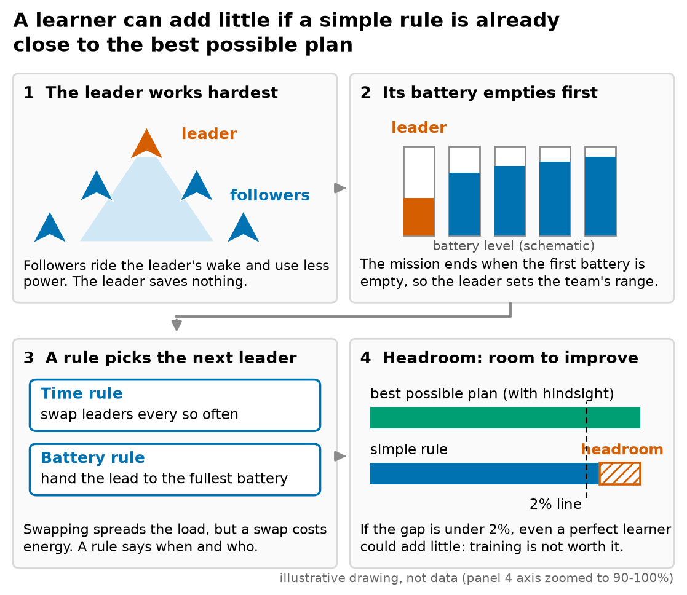
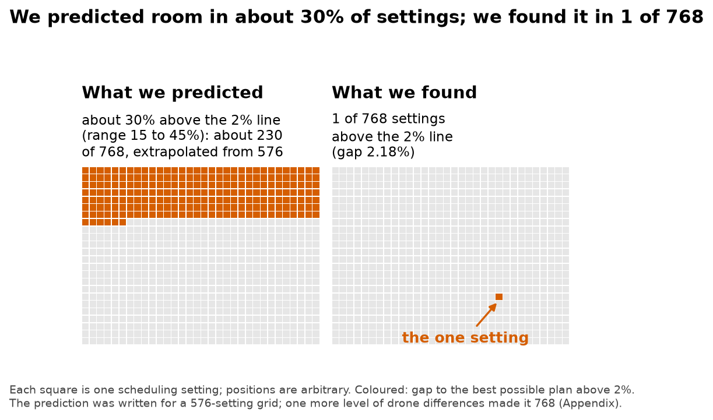
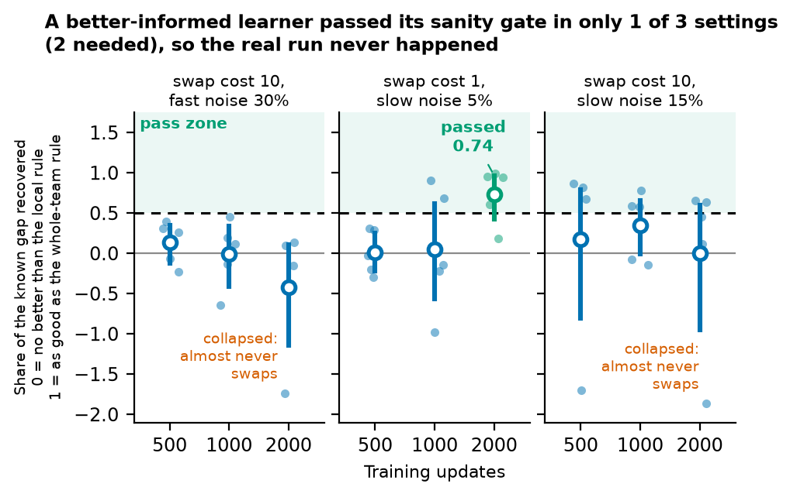

# Measure Before You Train: A Prediction-First Headroom Test for Learned Policies in Drone Formations

**In simulated drone formations, a simple hand-written rule is within 2% of the best plan in hindsight in all but 8 of 960 basic and richer leader-rotation settings (one rule that reads battery levels; the other two tasks depend on the reference and on information); one gap, when drones see only their neighbours, remains, and our learner did not pass its own sanity check, so we draw no conclusion about it.**

[中文版](README.zh-TW.md) | [Repository](https://github.com/Jadiouo/measure-before-you-train) | [Paper (PDF)](paper/main.pdf) | [Web page](https://jadiouo.github.io/measure-before-you-train/) ([English](https://jadiouo.github.io/measure-before-you-train/en.html))

A failed reinforcement-learning run cannot tell "no room to improve" from "training went badly", so this project measures the room first. The headroom test has three steps: (1) commit a written prediction, (2) measure how far a hand-written rule falls short of an offline upper bound (the best result achievable with hindsight) across a grid of settings, and (3) let a learner in only after it passes a sanity gate on settings where an improvement is known to exist. We apply it to three simulated fixed-wing drone tasks: leader rotation (who leads, and when), wake surfing (holding the best spot behind the leader) and cooperative soaring (gliders sharing rising air). The contribution is the protocol, not a new controller.

Most of the code, experiments, analysis and drafting were done by AI coding agents (Anthropic's Claude models, used through Claude Code) under the author's direction; the author set the research question and made every change of direction. Everything is simulation; there is no real aircraft.



*The headroom test in one picture. Illustrative drawing, not data.*

## Main results

- **The prediction missed.** We predicted that the best rule would leave more than 2% of room in about 30% of richer rotation settings, mostly where drones differ most; it did in 1 of 768, and not there (largest gap in the high-difference settings: 0.59%).
- **Leader rotation.** A rule that reads battery levels stays within 2% of the bound (relative gap) in all but 4 of 192 basic settings and 4 of 768 richer ones; a time rule is beyond 2% in 132 of 192 basic settings (largest 12.14%).
- **Wake surfing.** The best classical controller falls more than 2 percentage points (pp) of total power behind a perfect-position reference in 16 of 108 settings (all with a manoeuvring leader; largest 2.79 pp). A same-noisy-GPS reference shows at most 1.77 pp, but it is a diagnostic, not a cap on a learner.
- **Cooperative soaring.** A method given true thermal data beats the simple rule by over 2 pp of altitude in 10 of 11 settings, but when the simple rule is given the same data, no setting is confidently above 2 pp (largest lead +2.5 pp [0.1, 5.1]).
- **One unresolved gap.** With only neighbour information, the best rule trails a whole-team rule by 0.52 to 2.17% of the bound in 23 settings selected for showing a gap.
- **No conclusion on that gap.** Our multi-agent PPO learner, even given whole-team information, passed its sanity gate in only 1 of 3 control settings (2 were required), so we do not know whether learning can close it.
- Caveats: all results come from simulation with assumed physics (the share of induced drag in total power is swept, not measured); the 2% line is our own choice; for soaring and wake surfing the reference is not an optimum, so "close to the bound" is weaker evidence there than in rotation; the test is necessary rather than sufficient (a small gap does not mean learning has no other value); prediction timestamps are git author times, which the author can set.

The full method, statistics and limitations are in the paper. Every number in the paper is listed with its source in [`docs/canonical_numbers.md`](docs/canonical_numbers.md).



*Predicted (left) versus observed (right) share of richer rotation settings with more than 2% headroom.*



*Sanity gate of the second preregistration: only one of three control settings passes at 2000 updates, so the real neighbours-only run was never made.*

## Reproduce

Python >= 3.10. The project uses the repository's virtual environment (`.venv`); simulation scripts need numpy, scipy, jax and matplotlib (`pip install -e ".[dev]"` installs them all; plain `pip install -e .` leaves out scipy and matplotlib).

```bash
python -m venv .venv && . .venv/bin/activate
pip install -e ".[dev]"

# tests (always with a memory cap; the whole suite takes about 5 minutes)
systemd-run --user --scope -q -p MemoryMax=5G -p MemorySwapMax=0 .venv/bin/python -m pytest -q tests/test_physics.py

# rebuild the paper figures and paper/figures/numbers.json from the result files in calib/out/
.venv/bin/python scripts/make_paper_figs.py

# rebuild the two web pages (figures are inline SVG; needs `pdfinfo` from poppler)
python3 scripts/build_portfolio_pages.py
```

Pinned package versions (Python 3.12.3, generated 2026-11-19): `requirements-lock.txt` for `.venv` and `requirements-gpu-lock.txt` for the GPU environment `.venv-gpu`; install the project itself with `pip install -e .` (or `pip install -e ".[dev]"`). Running a measurement script with `--quick` and no `--out` writes to `.scratch/quick/`, not to `calib/out/`.

The measurements themselves (each writes its JSON to `calib/out/`; the committed JSON files are what the figure scripts read):

```bash
CAP="systemd-run --user --scope -q -p MemoryMax=12G -p MemorySwapMax=0"
.venv/bin/python scripts/drone_bucket.py                 # basic rotation, 192 settings
$CAP .venv/bin/python scripts/drone_bucket_l1.py         # richer rotation, 768 settings (CPU, a few hours)
$CAP .venv/bin/python scripts/drone_bucket_l23.py --nlp 60   # noisy rotation, 160 settings (the paper used 60; the default is 40)
$CAP .venv/bin/python scripts/wake_headroom.py           # wake surfing, 108 settings (about 100 s)
$CAP .venv/bin/python scripts/soaring_headroom2.py --workers 3   # cooperative soaring, round 2 (writes soaring_headroom2.json)
$CAP .venv/bin/python scripts/soaring_headroom3.py --workers 3   # cooperative soaring, round 3
# learner sanity gate (GPU recommended); see the usage line in the script and Appendix F of the paper
.venv/bin/python scripts/l3_mappo_vmap.py --cells N5_ar10_s0.3_p0.0_c10_h0.0,N5_ar50_s0.05_p0.0_c1_h0.0,N5_ar50_s0.15_p0.0_c10_h0.0 --seeds 0,1,2,3,4 --updates 2000 --control --none_bias 2.0 --outdir <dir>   # second preregistration; the first used the default 5.0 and 3 seeds
.venv/bin/python scripts/l3_analyze.py control <dir> --out <file.json>
# rebuild the two committed control JSONs from the raw per-seed files in calib/out/l3_raw/ (writes to .scratch/l3_merge_check/, never over calib/out)
.venv/bin/python scripts/l3_merge_control.py
```

Run these one at a time: they are heavy. The predictions written before each measurement, including the learner's two preregistrations (files 10 and 11), are in `docs/predictions/` (a few passages masked, see `docs/predictions/README.md`; the commit record is in `docs/provenance.md`) (see Appendix I of the paper for the commit-time table and Appendix J for the tally of all predictions).

### Open the page

Online: <https://jadiouo.github.io/measure-before-you-train/> (Chinese) and <https://jadiouo.github.io/measure-before-you-train/en.html> (English). To open it locally:

```bash
cd web/portfolio && python3 -m http.server 8765
# Chinese: http://localhost:8765/    English: http://localhost:8765/en.html
```

The page needs no external service.

## What can be reproduced from the public files alone

Checked on this repository's files only (no private inputs):

- **Paper numbers and figures from the result files.** `python scripts/make_paper_figs.py` reads `calib/out/*.json` and rewrites `paper/figures/` and `paper/figures/numbers.json` (the 117 numbers come out identical to the committed file; light, under a minute).
- **The two learner-control JSONs from raw per-seed files.** `python scripts/l3_merge_control.py` reads `calib/out/l3_raw/` and writes to `.scratch/l3_merge_check/`. `l3_mappo_control.json` is identical to the committed file; `l3_mappo_control_v2.json` is identical except for its hand-written `meta` entry.
- **The web pages.** `python3 scripts/build_portfolio_pages.py` rebuilds `web/portfolio/index.html` and `en.html` (output identical to the committed pages). `cd web && npm test` runs the 43 Node tests of the bird-formation viewer; it uses only Node built-ins, so no `npm install` is needed.
- **Unit tests.** `python -m pytest -q tests/` collects 197 tests. `tests/test_physics.py::test_matches_poc` needs `poc/wake_rotation_poc.py` (included, the early prototype it compares against); a few tests skip themselves when the training outputs of the earlier bird-formation work (`runs/`) are absent.
- **The appendix prediction tables.** `python scripts/gen_scorecard.py` reads `docs/predictions/` and `scripts/scorecard_rows.py` and writes to `.scratch/scorecard_check/`: `appendix_predictions.tex` is identical to `paper/appendix_predictions.tex`; the supplement's tables are identical to `paper/supplement_predictions.tex` except its hand-edited preamble.
- **Re-measurement.** The scripts under "The measurements themselves" above need no private input. Without `--quick` they overwrite the committed JSON in `calib/out/`, so copy it first or pass `--out`. The two integer-programming scripts use a wall-clock solver limit, so another machine can end with a different number of timed-out settings, and `make_paper_figs.py` asserts the published counts and stops if they differ.

Not reproducible from this repository:

- The learner training itself (`l3_mappo_vmap.py`, GPU): the per-seed outputs are in `calib/out/l3_raw/`, but the training logs behind the entropy value and the GPU-seconds figure in the paper are not included.
- The bird-formation numbers quoted in the introduction and in the appendix on the 3-bird game (`analyze_survival_v2.py`, `run_*`, `m3basin_*`, `m4br_*`, `m2gate_*`, `export_policy_js.py` and similar): they read checkpoints and rollouts under `runs/`, which is not included.
- The language-model commander table: the raw model outputs read by `scripts/llm_commander.py score` are not included.
- `docs/predictions/scorecard_sources.md` (the per-row sources of the prediction tables): `scripts/gen_scorecard.py` regenerates it only when the author's private result notes are present, so here it is a committed file, not a reproducible output.

## Project structure

| Path | Contents |
|---|---|
| `paper/` | `main.tex`, `main.pdf`, `refs.bib`, `figures/` (paper figures and `numbers.json`) |
| `docs/canonical_numbers.md` | Source of every number in the paper |
| `scripts/` | Measurements (`drone_bucket*.py`, `wake_headroom.py`, `soaring_headroom*.py`, `l3_*.py`), the paper-figure script (`make_paper_figs.py`) and the page builder (`build_portfolio_pages.py`); `make_web_figs.py` and `export_portfolio_data.py` made figures and data for an earlier version of the web page and are no longer used: the current pages are produced only by `build_portfolio_pages.py` |
| `calib/out/` | Result JSON files read by the figure scripts |
| `src/animalbench/` | Earlier simulator and multi-agent learning code (formation physics, MAPPO) |
| `web/portfolio/` | The two pages (`index.html` Chinese, `en.html` English) with `style.css`, `js/route.js`, `fonts/` and copies of the paper and supplement PDFs; all generated by `build_portfolio_pages.py` |
| `web/src`, `web/test` | A separate bird-formation viewer with its own tests (`cd web && npm test`) |
| `tests/` | Unit tests for the simulator and learners |
| `docs/` | Numbers' sources, the prediction files and their commit record, citation checks of the methods |

Comments and docstrings in the code that mention `notes/`, `spec vX.Y`, `runs/` and similar refer to notes and intermediate files in the author's private development repository; they are not part of this public export.

## Author

Hao-Ting Ho. Most of the code, experiments, analysis and drafting were done by AI coding agents (Anthropic's Claude models, used through Claude Code) under the author's direction; internal reviews of the drafts were also simulated with AI agents. The author set the research question, made every change of direction, proposed the direction of each prediction (AI agents expanded these into the written prediction files) and takes full responsibility for the content (see "Author contributions" in the paper).

## License

- Code and all files not marked otherwise: MIT, see [`LICENSE`](LICENSE).
- The paper and the figures: Creative Commons Attribution 4.0 International (CC BY 4.0), see [`paper/LICENSE`](paper/LICENSE) and [`web/portfolio/LICENSE`](web/portfolio/LICENSE) (the page figures and PDF copies; the fonts follow their own OFL files in `web/portfolio/fonts/`).
