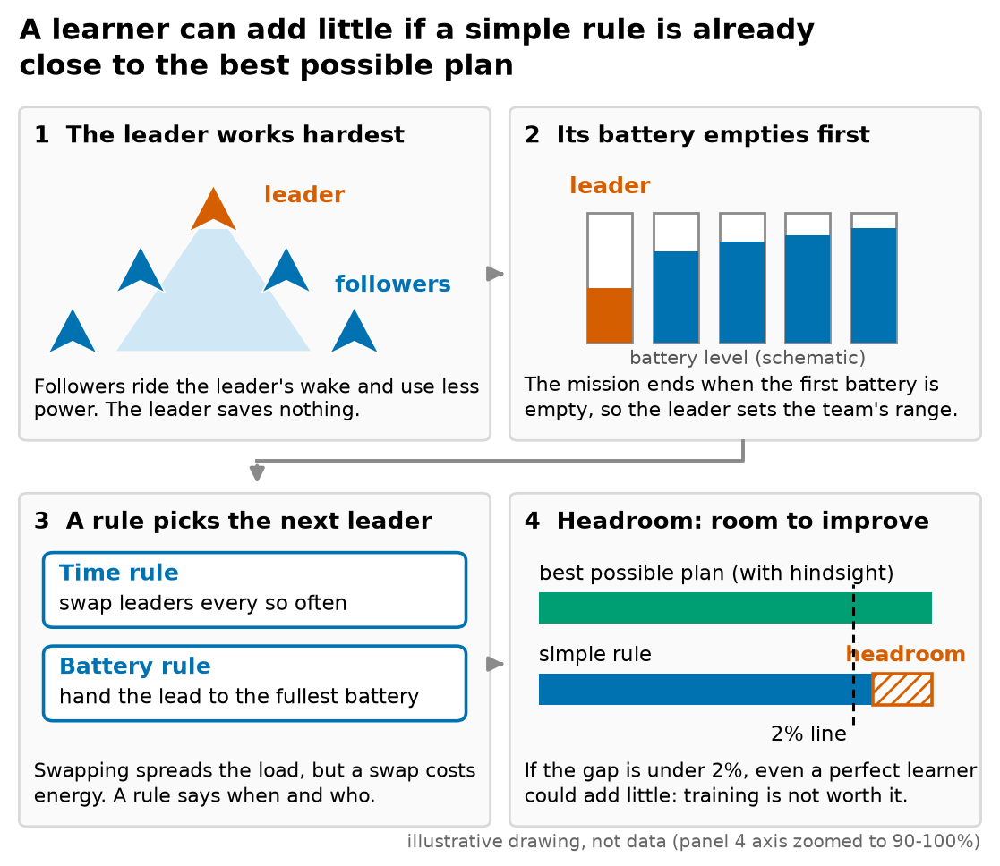
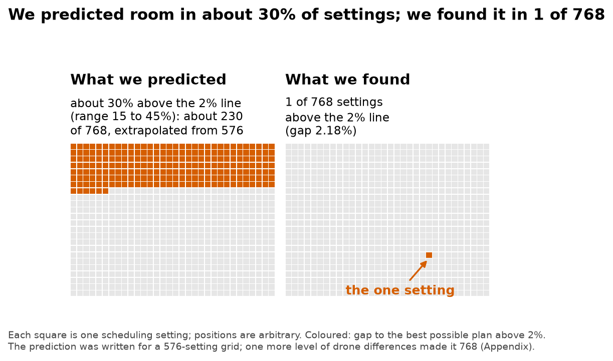
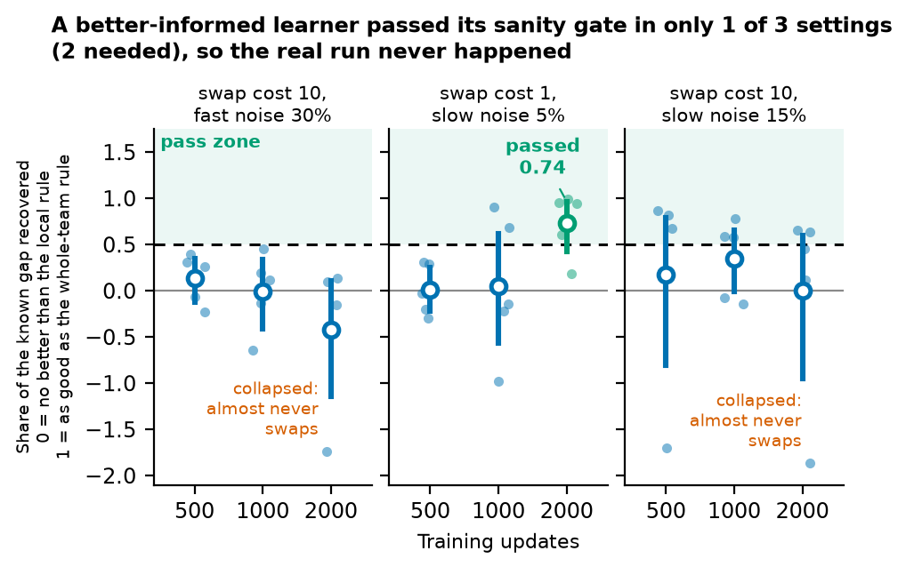

# 先量再訓練：無人機編隊裡，學習式策略的「先寫預測」進步空間測試

（English title: Measure Before You Train: A Prediction-First Headroom Test for Learned Policies in Drone Formations）

**在模擬的無人機輪流排程裡，看電量的單一簡單規則在 960 個情境（基本層 192＋較複雜層 768）中有 8 個離「事後看來的最佳做法」超過 2%；只看鄰居時還有一個缺口，而我們的學習者沒有通過自己的資格考，所以對那個缺口沒有結論（另兩個任務的差距取決於資訊與比較對象）。**

[English](README.md) | [專案網址](https://github.com/Jadiouo/measure-before-you-train) | [論文（PDF，英文）](paper/main.pdf) | [網頁](https://jadiouo.github.io/measure-before-you-train/)（[English](https://jadiouo.github.io/measure-before-you-train/en.html)）

強化學習跑失敗時，分不出是「本來就沒有進步空間」還是「訓練沒訓練好」，所以這個專案先量進步空間。進步空間測試分三步：(1) 先寫下並提交預測；(2) 在一整格情境裡，量手寫規則離離線上界（事後什麼都知道時最好能做到的結果）還差多少；(3) 學習者要先在「已知有進步空間」的情境上通過資格考，結果才採信。我們把它用在三個模擬的固定翼無人機任務：輪流領頭（誰領頭、什麼時候換）、貼尾流（保持在領機後方的最佳位置）、合作找上升氣流（滑翔機分享上升氣流的位置）。貢獻是這套流程，不是新的控制器。

多數程式、實驗、分析與文稿由 AI 程式代理（Anthropic 的 Claude 模型，透過 Claude Code）在作者指示下完成；作者提出研究問題並做每一次方向決定。全部是電腦模擬，沒有實機。



*進步空間測試一張圖。示意圖，不是資料。*

## 主要結果

- **預測錯了。** 我們預測，在較複雜的輪流領頭情境中，約 30% 會讓最好的規則落後最佳做法超過 2%，而且多半出在無人機彼此差異最大的地方；實際 768 個裡只有 1 個，而且不在那裡（個體差異大的情境最大只有 0.59%）。
- **輪流領頭。** 看電量的規則，在 192 個基本情境中除了 4 個，以及 768 個較複雜情境中除了 4 個，離上界都在 2% 以內（相對差距）；定時輪流在 192 個基本情境中有 132 個超過 2%（最大 12.14%）。
- **貼尾流。** 最好的傳統控制器，在 108 個情境中有 16 個落後「完美位置參考」超過 2 個百分點（佔總功率；全是領機有動作的情境，最大 2.79 pp）。對「拿到同樣雜訊 GPS」的參考最大只有 1.77 pp，但那只是診斷，不是學習者的上限。
- **合作找上升氣流。** 拿到熱氣流真實資料的方法，在 11 個設定中的 10 個領先簡單規則超過 2 pp（佔高度）；但若簡單規則也拿到同樣的資料，沒有任何設定穩穩超過 2 pp（最大領先 +2.5 pp [0.1, 5.1]）。
- **一個沒解決的缺口。** 只有鄰居資訊時，最好的規則在 23 個「因為有缺口才挑出來」的情境中，落後看得到全隊的規則 0.52 到 2.17%（佔上界）。
- **對那個缺口沒有結論。** 我們的多智能體 PPO 學習者，就算給它全隊資訊，在 3 個對照情境中也只通過 1 個（要求 2 個），所以我們不知道學習能不能縮小那個缺口。
- 限制：全部來自模擬，物理是假設的（誘導阻力佔總功率的比例是掃描，不是量測）；2% 是我們自訂的；滑翔與貼尾流的參考不是最佳解，所以「接近上界」的證據比輪流領頭弱；這個測試是必要而非充分（差距小不代表學習沒有別的價值）；預測的時間戳是 git 作者時間，作者可以自己設定。

完整方法、統計與限制在論文裡。論文每一個數字的來源列在 [`docs/canonical_numbers.md`](docs/canonical_numbers.md)。



*預測（左）與實際（右）：較複雜輪流情境中差距超過 2% 的比例。（論文圖為英文。）*



*第二份預先登記的資格考：2000 次更新時，3 個對照情境只有 1 個通過，所以沒有去跑真正「只看鄰居」的學習。（論文圖為英文。）*

## 如何重現

Python >= 3.10。使用專案的虛擬環境 `.venv`；模擬腳本需要 numpy、scipy、jax、matplotlib（`pip install -e ".[dev]"` 會全部裝好；只打 `pip install -e .` 不會裝 scipy 與 matplotlib）。

```bash
python -m venv .venv && . .venv/bin/activate
pip install -e ".[dev]"

# 測試（一律加記憶體上限；整套約 5 分鐘）
systemd-run --user --scope -q -p MemoryMax=5G -p MemorySwapMax=0 .venv/bin/python -m pytest -q tests/test_physics.py

# 由 calib/out/ 的結果檔重畫論文圖並重寫 paper/figures/numbers.json
.venv/bin/python scripts/make_paper_figs.py

# 重新產生兩個網頁（圖是 inline SVG；需要 poppler 的 `pdfinfo`）
python3 scripts/build_portfolio_pages.py
```

鎖定的套件版本（Python 3.12.3，2026-11-19 產生）：`requirements-lock.txt`（`.venv`）與 `requirements-gpu-lock.txt`（GPU 環境 `.venv-gpu`）；專案本身用 `pip install -e .`（或 `pip install -e ".[dev]"`）安裝。量測腳本加 `--quick` 又沒給 `--out` 時，輸出寫到 `.scratch/quick/`，不會動 `calib/out/`。

量測本身（各自把 JSON 寫進 `calib/out/`；圖表腳本讀的就是已提交的 JSON）：

```bash
CAP="systemd-run --user --scope -q -p MemoryMax=12G -p MemorySwapMax=0"
.venv/bin/python scripts/drone_bucket.py                 # 基本輪流，192 個情境
$CAP .venv/bin/python scripts/drone_bucket_l1.py         # 較複雜輪流，768 個情境（CPU，數小時）
$CAP .venv/bin/python scripts/drone_bucket_l23.py --nlp 60   # 有雜訊的輪流，160 個情境（論文用 60，預設是 40）
$CAP .venv/bin/python scripts/wake_headroom.py           # 貼尾流，108 個情境（約 100 秒）
$CAP .venv/bin/python scripts/soaring_headroom2.py --workers 3   # 合作找上升氣流，第二輪（寫出 soaring_headroom2.json）
$CAP .venv/bin/python scripts/soaring_headroom3.py --workers 3   # 合作找上升氣流，第三輪
# 學習者資格考（建議用 GPU）；用法見腳本開頭與論文附錄 F
.venv/bin/python scripts/l3_mappo_vmap.py --cells N5_ar10_s0.3_p0.0_c10_h0.0,N5_ar50_s0.05_p0.0_c1_h0.0,N5_ar50_s0.15_p0.0_c10_h0.0 --seeds 0,1,2,3,4 --updates 2000 --control --none_bias 2.0 --outdir <dir>   # 第二份預先登記（第一份用預設 5.0 與 3 個種子）
.venv/bin/python scripts/l3_analyze.py control <dir> --out <file.json>
# 由 calib/out/l3_raw/ 的逐種子原始檔重建兩份已提交的對照 JSON（寫到 .scratch/l3_merge_check/，不會覆蓋 calib/out）
.venv/bin/python scripts/l3_merge_control.py
```

這些很重，請一次只跑一個。每次量測之前先寫下的預測（含學習者的兩份預先登記，第 10、11 號檔）在 `docs/predictions/`（少數段落已遮蔽，見 `docs/predictions/README.md`；提交紀錄在 `docs/provenance.md`）（提交時間表見論文附錄 I，全部預測的統計見附錄 J）。

### 開啟網頁

線上版：<https://jadiouo.github.io/measure-before-you-train/>（中文）與 <https://jadiouo.github.io/measure-before-you-train/en.html>（英文）。要在本機開啟：

```bash
cd web/portfolio && python3 -m http.server 8765
# 中文：http://localhost:8765/    英文：http://localhost:8765/en.html
```

網頁不需要任何外部服務。

## 哪些東西可以直接用公開的檔案重現

以下只用這個倉庫裡的檔案確認過（不需要任何私人輸入）：

- **由結果檔重算論文數字與圖。** `python scripts/make_paper_figs.py` 讀 `calib/out/*.json`，重寫 `paper/figures/` 與 `paper/figures/numbers.json`（117 個數字與已提交的檔案完全相同；很輕，不到一分鐘）。
- **由逐種子原始檔重建兩份學習者對照 JSON。** `python scripts/l3_merge_control.py` 讀 `calib/out/l3_raw/`，輸出到 `.scratch/l3_merge_check/`。`l3_mappo_control.json` 與已提交的檔案相同；`l3_mappo_control_v2.json` 除了手寫的 `meta` 欄位外相同。
- **網頁。** `python3 scripts/build_portfolio_pages.py` 重建 `web/portfolio/index.html` 與 `en.html`（輸出與已提交的頁面相同）。`cd web && npm test` 跑鳥類編隊 viewer 的 43 個 Node 測試；只用 Node 內建模組，不需要 `npm install`。
- **單元測試。** `python -m pytest -q tests/` 收集到 197 個測試。`tests/test_physics.py::test_matches_poc` 要對照 `poc/wake_rotation_poc.py`（早期的原型腳本，已附上）；另有幾個測試在缺少較早的鳥類編隊工作的訓練輸出（`runs/`）時會自己跳過。
- **附錄的預測對照表。** `python scripts/gen_scorecard.py` 讀 `docs/predictions/` 與 `scripts/scorecard_rows.py`，輸出到 `.scratch/scorecard_check/`：`appendix_predictions.tex` 與 `paper/appendix_predictions.tex` 完全相同；補充檔的表與 `paper/supplement_predictions.tex` 相同，只差手改過的 preamble。
- **重新量測。** 上面「量測本身」列的腳本不需要任何私人輸入。不加 `--quick` 時會覆蓋 `calib/out/` 內已提交的 JSON，所以請先備份或加 `--out`。兩支整數規劃腳本用牆鐘時間當求解器上限，換一台機器逾時的情境數可能不同，而 `make_paper_figs.py` 會對已發表的數字做 assert，不同就中止。

不能只靠這個倉庫重現的部分：

- 學習者的訓練本身（`l3_mappo_vmap.py`，GPU）：逐種子的輸出在 `calib/out/l3_raw/`，但論文中熵值與 GPU 秒數所依據的訓練 log 沒有附上。
- 引言與「3 隻鳥輪替遊戲」附錄引用的鳥類編隊數字（`analyze_survival_v2.py`、`run_*`、`m3basin_*`、`m4br_*`、`m2gate_*`、`export_policy_js.py` 等）：它們讀取 `runs/` 底下的檢查點與 rollout，那些沒有附上。
- 語言模型指揮官的表：`scripts/llm_commander.py score` 讀的模型原始輸出沒有附上。
- `docs/predictions/scorecard_sources.md`（預測表逐列來源）：`scripts/gen_scorecard.py` 只有在作者私人的結果筆記存在時才會重新產生它，所以在這裡它是已提交的檔案，不是可重現的輸出。

## 專案結構

| 路徑 | 內容 |
|---|---|
| `paper/` | `main.tex`、`main.pdf`、`refs.bib`、`figures/`（論文圖與 `numbers.json`） |
| `docs/canonical_numbers.md` | 論文每個數字的來源 |
| `scripts/` | 量測（`drone_bucket*.py`、`wake_headroom.py`、`soaring_headroom*.py`、`l3_*.py`）、論文圖腳本（`make_paper_figs.py`）與網頁產生器（`build_portfolio_pages.py`）；`make_web_figs.py` 與 `export_portfolio_data.py` 是替較早版本的網頁產生圖與資料的，已不再使用：目前的頁面只由 `build_portfolio_pages.py` 產生 |
| `calib/out/` | 圖表腳本讀取的結果 JSON |
| `src/animalbench/` | 較早的模擬器與多智能體學習程式（隊形物理、MAPPO） |
| `web/portfolio/` | 兩個網頁（`index.html` 中文、`en.html` 英文）與 `style.css`、`js/route.js`、`fonts/`、論文與補充檔 PDF 的複本；全部由 `build_portfolio_pages.py` 產生 |
| `web/src`、`web/test` | 獨立的鳥類編隊 viewer 與它的測試（`cd web && npm test`） |
| `tests/` | 模擬器與學習者的單元測試 |
| `docs/` | 數字的來源、預測檔與提交紀錄、方法文獻的查核紀錄 |

程式註解與 docstring 裡提到的 `notes/`、`spec vX.Y`、`runs/` 等，指的是作者私人開發版本庫裡的筆記與中間檔，不在這個公開匯出裡。

## 作者

Hao-Ting Ho。多數程式、實驗、分析與文稿由 AI 程式代理（Anthropic 的 Claude 模型，透過 Claude Code）在作者指示下完成，草稿的內部審查也是用 AI 代理模擬；作者提出研究問題、做每一次方向決定、提出每份預測的方向（由 AI agent 擴寫成預測檔），並對內容負全責（見論文的「Author contributions」）。

## 授權

- 程式與未另行標示的檔案：MIT，見 [`LICENSE`](LICENSE)。
- 論文與圖：Creative Commons Attribution 4.0 International（CC BY 4.0），見 [`paper/LICENSE`](paper/LICENSE) 與 [`web/portfolio/LICENSE`](web/portfolio/LICENSE)（網頁裡的圖與 PDF 複本；字型依 `web/portfolio/fonts/` 裡各自的 OFL 授權檔）。
